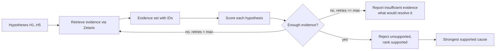
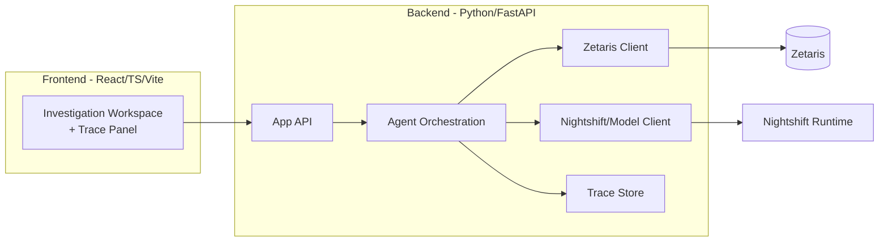

# ARCHITECTURE.md — Uhakika System Architecture

> **Status:** Design/specification only. **No technologies are claimed as installed unless verified.** Components not yet built or decided are explicitly marked **`TBD`**. The Python files in `agent/` are currently empty placeholders.

---

## 1. High-Level Architecture

Uhakika is an **evidence-driven investigation agent**. A user asks why a receivable is unpaid. The system forms competing hypotheses, retrieves real evidence through **Zetaris** (mandatory data layer), evaluates each hypothesis against evidence, rejects unsupported ones, retries when needed, selects the strongest supported cause, quantifies revenue at risk, recommends an action, and **requires human approval** for consequential actions — recording an operational trace throughout.

Two orthogonal pillars:
- **Fragmented-data reasoning (Track 1 strength):** evidence is spread across contracts, invoices, deliveries, acceptance, correspondence, guarantees, and payment status — federated via Zetaris.
- **Explainable "why" (Track 2 core):** the output is a hypothesis-evaluation trail with evidence references, not a bare answer.

```mermaid
flowchart TD
  U[User / UI] --> RUN[POST /run]
  RUN --> IR[Intent Router<br/>routing stage; LIVE powered by Meterless Engine: Scout Intent (required, TBD)<br/>fallback labeled<br/>NOT a core agent]
  IR --> INV[InvestigatorAgent<br/>hypotheses + orchestration + shared case state]
  INV --> EA[EvidenceAgent]
  EA --> Z[(Zetaris Data Layer<br/>REST + SQL)]
  Z --> EA
  EA --> EV[EvaluatorAgent]
  EV -->|insufficient evidence| EA
  EV -->|supported conclusion| INV
  INV --> REC[Recommendation + Human Approval gate]
  REC -->|approve| FUP[Follow-up / Verification - STRETCH]
  REC -->|reject| INV
  ACT[ActionAgent - STRETCH] -.optional.-> REC
  INV -.trace.-> LOG[(Trace Log)]
  EA -.trace.-> LOG
  EV -.trace.-> LOG
  RT[Meterless Nightshift<br/>AI Runtime - TBD] -.powers.-> INV
  RT -.powers (Nemotron via METERLESS_MODEL).-> EV
  NM[Nemotron route via Nightshift<br/>METERLESS_MODEL - TBD] -.served via.-> RT
```

**Runtime vs. build tooling:** Qoder/Qwen (Qwen 3.8 Flash) assist development only. The **product AI runtime is Meterless Nightshift** (integration `TBD` until a Nightshift receipt verifies it). The live model route is read from **`METERLESS_MODEL`** and must never be hardcoded; **Nemotron (via Nightshift) powers EvaluatorAgent's evidence critique**. **OpenRouter may sit as a provider *behind* Nightshift — never call it directly from application code and never install an OpenRouter extension.**

---

## 2. Request Lifecycle

1. **Ingest question via `POST /run`** — a judge/UI calls the single endpoint with "Why hasn't invoice X been paid?" (or the hero TZS 126,000,000 invoice).
2. **Intent routing** — the **Intent Router stage** classifies the request and selects the investigation playbook. It is a routing stage, **not one of our agents**; for the **live** path it is powered by the required Meterless Engine **Scout Intent** — until Scout Intent is wired and verified, a deterministic fallback router is used and clearly labeled `fallback` (never Scout Intent).
3. **Shared case state initialized** — an investigation `case` object (see §3b) is created to carry operational state between agents.
4. **Hypothesis generation** — InvestigatorAgent enumerates competing hypotheses H1–H5.
5. **Evidence retrieval** — EvidenceAgent issues Zetaris queries (fresh request ID each, one SQL statement per call) to gather records relevant to each hypothesis.
6. **Evaluation** — EvaluatorAgent scores each hypothesis against retrieved evidence; rejects unsupported ones with reasons.
7. **Retry / branch** — if evidence is insufficient, loop back to EvidenceAgent for targeted retrieval (bounded retries).
8. **Conclusion** — select strongest supported cause; classify blocker (supplier-controllable / execution / external).
9. **Quantify** — compute revenue at risk from the invoice/contract.
10. **Recommend + approve** — the InvestigatorAgent/orchestrator drafts the recommendation and manages the **human approval gate** (a dedicated **ActionAgent is STRETCH**).
11. **Trace** — every step writes an operational trace (never chain-of-thought).

```mermaid
sequenceDiagram
  participant J as Judge/UI (POST /run)
  participant IR as Intent Router (stage; Scout Intent for live / fallback)
  participant INV as InvestigatorAgent
  participant EA as EvidenceAgent
  participant Z as Zetaris
  participant EV as EvaluatorAgent
  participant H as Human (approval gate)
  J->>IR: POST /run "Why is INV-004 unpaid?"
  IR->>INV: route to revenue-assurance playbook
  INV->>INV: generate H1..H5, init shared case state
  loop until sufficient or bounded retries
    INV->>EA: request evidence per hypothesis
    EA->>Z: SQL query (fresh request id, 1 stmt)
    Z-->>EA: records (evidence ids)
    EA-->>INV: append evidence to case state
    INV->>EV: evaluate hypotheses vs evidence
    EV->>EV: score + reject unsupported (reasons)
    EV-->>INV: supported/rejected verdicts + confidence
  end
  INV->>INV: pick supported cause, quantify revenue at risk, draft recommendation
  INV-->>J: conclusion + evidence + recommendation (pending approval)
  J->>H: consequential action requires approval
  H-->>J: approve / reject (recorded in trace)
```

---

## 3. Agents and Responsibilities

At least **two named agents perform distinct work**. **V0 uses three core agents** (`InvestigatorAgent`, `EvidenceAgent`, `EvaluatorAgent`); a fourth, `ActionAgent`, is **STRETCH** (some agents may share a process; responsibilities stay distinct).

| Agent | Responsibility | Inputs | Outputs |
|---|---|---|---|
| **Intent Router** — *routing stage, NOT a core agent* (live path powered by the required Meterless Engine **Scout Intent**; deterministic `fallback` router until verified) | Classify request; select investigation playbook | user question / `POST /run` payload | routed task + case init |
| **InvestigatorAgent** *(core)* | Frame the case; hold the **shared case state**; generate competing hypotheses; orchestrate the loop; decide when to stop; draft recommendation + run approval gate | routed task, evidence status | hypothesis set, conclusion selection, recommendation, approval state |
| **EvidenceAgent** *(core)* | Retrieve and normalize evidence via Zetaris only | hypothesis evidence needs | evidence records with IDs + source summaries |
| **EvaluatorAgent** *(core)* | Critique: score each hypothesis vs. evidence; reject unsupported; flag insufficiency (live critique uses **Nemotron through Nightshift**) | hypotheses + evidence | supported/rejected verdicts + confidence |
| **ActionAgent** *(STRETCH)* | Separate proposal + follow-up/verification | supported cause | recommendation + approval state (folded into InvestigatorAgent in V0) |

Distinct capabilities the design must *visibly demonstrate*: **delegation** (Investigator→Evidence→Evaluator), **evidence retrieval** (Zetaris), **critique** (Evaluator rejecting hypotheses), **retry/branching** (bounded evidence loop), **tool use** (Zetaris query tool), **grounded conclusions** (evidence IDs), **shared context** (the case object below), and **trace logs**.

---

## 3b. Shared Case State

Agents pass a single **investigation `case` object** (shared context). It carries **operational state only — never hidden reasoning / chain-of-thought**. Conceptual shape (not implemented):

```
case = {
  case_id,
  question,
  invoice_id,
  contract_id,
  hypotheses,          # H1..H5 with status
  evidence,            # records + ids + source summaries
  retries,             # retry_count + budget
  supported_cause,
  rejected_hypotheses, # each with an evidence-based reason
  recommendation,
  approval_status,     # e.g., pending | approved | rejected
  trace                # ordered operational trace
}
```

The InvestigatorAgent owns/initializes the case; EvidenceAgent appends evidence; EvaluatorAgent writes verdicts; the approval gate updates `approval_status`. Nothing in the object exposes private reasoning.

---

## 4. Evidence Loop (core differentiator)



Rules:
- A hypothesis may be **rejected only with a reason tied to evidence (or its documented absence).**
- **Never fabricate evidence.** Absent data → insufficiency path, not invention.
- Retries are **bounded** (max retry count recorded in trace).
- The anti-fabrication property is testable: removing a cited evidence record must weaken/remove its conclusion.

---

## 5. Zetaris Role (mandatory data layer)

- **All core business evidence flows through Zetaris.** No bypass sources for business evidence.
- Local instance, **verified 9/9** during setup.
- **REST API** configured via the canonical variables `ZETARIS_REST_URL` (with `ZETARIS_ORG_ID`, `ZETARIS_API_KEY`). Expected local REST base value: `http://localhost:8888/api/v1.0`.
- **SQL endpoint pattern:** `/sql-editor/sqls/run`.
- **Every query uses a fresh request ID.** **One SQL statement per call.** **Lightning SQL rules apply.**
- Designed for **federation** across the logical datasets (see `DATA_CONTRACT.md`: contracts, invoices, deliveries, acceptance_records, communications, **compliance_items**, payment_status; guarantees optional).
- Credentials (`ZETARIS_ORG_ID`, `ZETARIS_API_KEY`) are provided via environment/config only — **never printed**. Reproducible synthetic CSV fixtures back the datasets and are exposed through Zetaris for live mode.

Conceptual EvidenceAgent → Zetaris call:
```
POST http://localhost:8888/api/v1.0/sql-editor/sqls/run
  body: { request_id: <fresh-uuid>, sql: "<single Lightning SQL statement>" }
  → result rows → normalized into evidence records with IDs
```
*(Exact request/response field names are `TBD` — confirm against the live Zetaris REST contract before implementation; do not invent them.)*

---

## 6. Meterless Nightshift Role (product AI runtime — `TBD`)

- Nightshift must be the **primary AI runtime/provider** for the product.
- Setup is **in progress**. The final **Runtime URL and token will be supplied via environment variables later** and are **`TBD`** — do not invent them.
- Agents that require generative reasoning (hypothesis framing, evaluation narrative, recommendation drafting) run through Nightshift.
- **Configuration surface (canonical names only):** `METERLESS_BASE_URL`, `METERLESS_RUNTIME_TOKEN` (secret), `METERLESS_MODEL` (values not recorded). **OpenRouter may sit behind Nightshift as a provider; never call it directly from application code, and never install an OpenRouter extension.**

---

## 7. Nemotron Role (reasoning model via Nightshift — configurable, `TBD`)

- Nemotron is the **desired reasoning model**, reached **through Nightshift**, and is the intended model powering **EvaluatorAgent's** evidence critique.
- Direct NVIDIA verification is currently problematic for Tanzania; **Nightshift-compatible Nemotron routing is being investigated.**
- **No hardcoded model IDs / endpoints.** Model selection is driven by **`METERLESS_MODEL`** and runtime routing config, resolved at runtime through Nightshift. The preferred test route `nvidia/nemotron-3.5-super-vl:free` is configuration only; **a provider/model is claimed only when the Nightshift receipt proves it.**
- Until verified, treat concrete model/route as `TBD` and never claim it in the demo beyond what actually ran.

---

## 8. Meterless Engine Role

- **Scout Intent is the required Meterless Engine** powering the **live** intent-routing stage (§3). Until it is wired and verified, a deterministic `fallback` router is used and **never** labeled Scout Intent. **World Model is deferred** (scenario simulation — long-term, out of V0).
- **Do not claim either Engine is implemented yet** — mark `TBD` until a real, verified feature exists.

---

## 9. Backend / Frontend Boundary



- **Frontend** (approved stack: **React + TypeScript + Vite + Tailwind CSS + shadcn/ui + Lucide React + TanStack Query**; Recharts only when a chart materially helps): one Investigation Workspace + Trace Panel. Vite proxies the backend during development; a production build may be served by FastAPI for a reproducible demo. **No Next.js, no plain static HTML as the main interface, no separate database.** Consumes the backend API only.
- **Backend** (Python + FastAPI + Uvicorn; Pydantic models; httpx clients): hosts the agent orchestration, the Zetaris client, the Nightshift/model client, and the trace store. The frontend never talks to Zetaris or the runtime directly.
- The **only required interface in V0 is the judge-facing `POST /run`** (see §10). Internal status/poll/approve/reject endpoints are **stretch** — in V0 the approval gate is handled inside the single `/run` flow or a local UI control, not extra endpoints. Exact routes/payloads remain `TBD` until implemented.

---

## 10. API Contracts (conceptual — not implemented)

> **`POST /run` is planned documentation only — no code exists yet.** These are conceptual shapes to align the team. **Do not treat as built.** Final field names must be validated against Zetaris and Nightshift contracts.

**Required judge-facing endpoint — `POST /run`**

Conceptual request:
```
{
  "question": "Why hasn't our TZS 126,000,000 invoice been paid?",
  "invoice_id": "INV-004",
  "sample_mode": false
}
```

Conceptual response:
```
{
  "case_id": "...",
  "revenue_at_risk": 126000000,
  "supported_cause": "...",
  "rejected_hypotheses": [],
  "evidence": [],
  "recommendation": "...",
  "trace": []
}
```

**Trace entry:** `{ ts, agent, action, tool/query, source_result_summary, decision, confidence, retry_count, model_route, evidence_ids }`

`GET /status`, polling, and separate `approve`/`reject` endpoints are **STRETCH** (not required for V0).

---

## 11. Logs / Traces

- **Operational traces only. No fake chain-of-thought. Never expose private reasoning.**
- Per-entry fields (from `AGENTS.md` §9): `agent`, `action`, `query`/`tool`, `source`/result summary, `decision` status, `confidence`, `retry_count`, `model_route`.
- Traces must reference **evidence IDs** and the hypotheses considered/rejected, and must contain **no credentials**.
- Trace store backing is `TBD` (in-memory for V0 likely; persisted later).

---

## 12. Retries

- Evidence loop uses **bounded retries** with a fresh request ID per Zetaris query; `retry_count` recorded each pass.
- Query-level transient failures (network/timeout) retry with backoff, up to a limit; on exhaustion, surface failure honestly rather than fabricating.
- **No infinite loops.** A max-retry constant is defined in config (value `TBD`).

---

## 13. Fallbacks

- **Nightshift/model route unavailable** → degrade to explicit **"insufficient capability"** state or **sample mode**; never claim live reasoning that did not occur.
- **Zetaris unavailable** → investigation cannot proceed on real evidence; show what failed (do not substitute fake evidence into a "live" conclusion).
- **Sample mode** (see §14) is the controlled fallback for the demo.

---

## 14. Sample Mode

- Deterministic execution over the **clearly-marked synthetic dataset** for the hero scenario, used to reproduce the PRD §7 result **shape** — never by storing the answer.
- **`SAMPLE_MODE=true` executes the same real pipeline**: request parsing, routing contract, investigation flow, evidence-retrieval interface, hypothesis evaluation, retry logic, result construction, and trace construction.
- It **may** use synthetic/cached evidence and a **credential-free local provider adapter** (so it needs no private Nightshift/NVIDIA credentials). It **must NOT** return a stored final answer — **the supported cause must still be derived from the supplied evidence during the run.**
- **Remove any notion of "simulated reasoning."** The only difference from live mode is the evidence source and the credential-free adapter, not skipping the logic.
- **UI/output must visibly label sample/synthetic mode** so no one mistakes synthetic data for a real receivable.
- **Sample mode is credential-free but is NOT sufficient as sponsor-tech proof.** Sponsor integration claims (Zetaris / Nightshift / Scout Intent / Nemotron) require a verified live receipt; a sample run must never be presented as such.

---

## 15. Security

- Secrets only via `.env` / config; **never logged, printed, or committed.** `.env` is Git-ignored; never force-add.
- Zetaris + Nightshift credentials referenced by variable name only.
- SQL: parameterize/validate identifiers; one statement per call; no untrusted string interpolation.
- Human approval gate for consequential actions; approval state immutable in trace.
- No real customer data to external services without an approved decision.
- Trace outputs exclude secrets and raw sensitive payloads.

---

## 16. Configuration

- Everything environment-driven and **configurable, never hardcoded**: runtime URL/token, model routing, Zetaris base URL, request-ID behavior, sample-vs-live mode, retry limits.
- **Canonical env var names** (values not recorded): `METERLESS_BASE_URL`, `METERLESS_RUNTIME_TOKEN`, `METERLESS_MODEL`, `ZETARIS_REST_URL`, `ZETARIS_ORG_ID`, `ZETARIS_API_KEY`, `SAMPLE_MODE`, `MAX_EVIDENCE_RETRIES`. Prohibited legacy aliases (`METERLESS_API_KEY`, `NEMOTRON_MODEL`, `ZETARIS_BASE_URL`) must be **ignored**, never silently migrated.
- A single config module loads and validates these at startup; missing required values fail loudly (no silent defaults to real endpoints).

---

## 17. Likely Folder Structure

> Reflects existing stubs. **Informational; not created in this phase.**

```
/ (repo root)
├── AGENTS.md  PRD.md  ARCHITECTURE.md  DATA_CONTRACT.md  BUILD_PLAN.md  BUILD_LOG.md
├── .env                 # ignored; secrets (names referenced in docs only)
├── .gitignore
├── .venv/               # ignored
├── hello.py             # pre-build placeholder
├── smoke_test.py        # end-to-end wiring test (currently empty)
├── prompts/             # prompt templates (empty; tracks files, not dir)
└── agent/
    ├── main.py          # entry point / orchestration      (empty stub)
    ├── llm.py           # Nightshift/Nemotron client wrapper (empty stub)
    └── tools_zetaris.py # Zetaris REST/SQL evidence tools    (empty stub)
```
Approved structure added during build: `frontend/` (React + TypeScript + Vite app: Investigation Workspace + Trace Panel), `data/fixtures/` (reproducible synthetic CSV hero datasets read by the credential-free sample adapter), and `tests/` (pytest). Backend stays under `agent/` (FastAPI). No Next.js and no extra database.

---

## 18. Open `TBD` Items (consolidated)

- Nightshift runtime URL + token (env-provided later).
- Concrete model route via `METERLESS_MODEL` (keep configurable; Nemotron through Nightshift; prove by a Nightshift receipt).
- Scout Intent wiring (required for the live routing stage; a deterministic `fallback` router is used until verified).
- Exact Zetaris REST request/response field names and auth flow (validate against live instance).
- Backend (Python/FastAPI) and frontend (React/TypeScript/Vite) stacks are chosen; package installation + clean-clone verification are pending in later phases.
- Internal API routes and payloads (conceptual only).
- Trace store persistence and max-retry constant value.
- `POST /run` request/response field names (conceptual above; **planned, not implemented** — no code exists).

Nothing above may be presented as built until verified and logged in `BUILD_LOG.md`.
