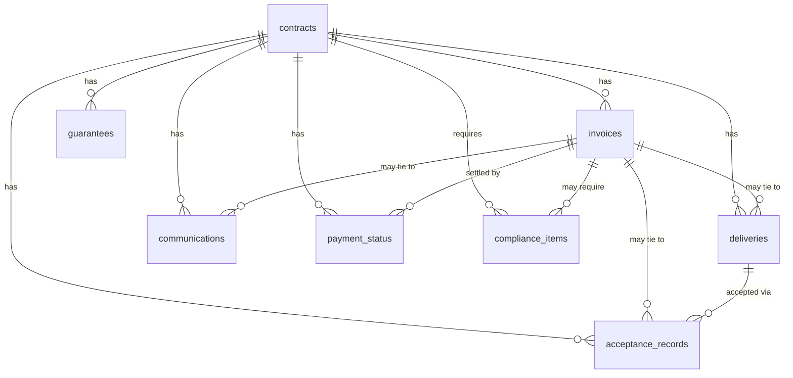

# DATA_CONTRACT.md — Uhakika Data Contract

> **Status:** Schema/specification only. Data is **synthetic** and loaded into **Zetaris** (the mandatory data layer). No real customer data. No implementation yet.

---

## 1. Purpose & Design Principles

Uhakika reasons over fragmented institutional-contract data to explain why a receivable is blocked. This contract defines the datasets, keys, fields, joins, nullability, enums, provenance, synthetic-data rules, query expectations, and validation rules. It is designed for **Zetaris federation** — logically separate sources joined by stable identifiers.

Principles:
1. **Every conclusion is traceable to evidence IDs.**
2. **Never fabricate evidence at runtime** — data exists or it does not; absence is a valid, meaningful state (a missing acceptance certificate bears on **H2**; a missing required compliance item bears on **H4** — see §11 hypothesis→data rules).
3. **Absence is data.** A missing/never-issued record is itself evidence; represent "not found" via query results, not invented rows, unless a field explicitly models a required-but-outstanding item.
4. **Synthetic but realistic**, and clearly marked as synthetic (see §7).
5. **Federation-friendly:** consistent `*_id` keys across sources; no cross-database assumptions beyond what Zetaris federates.

---

## 2. Identifier Convention

Stable, human-readable IDs used as evidence references (canonical demo uses these exact IDs):

| Entity | Key | Format example |
|---|---|---|
| Contract | `contract_id` | `CTR-001` |
| Invoice | `invoice_id` | `INV-004` |
| Delivery | `delivery_id` | `DEL-009` |
| Acceptance/certificate | `certificate_id` | `CERT-018` |
| Communication | `message_id` | `MSG-037` |
| Compliance item (required/submitted doc) | `item_id` | `CMP-005` |
| Guarantee/security *(stretch)* | `guarantee_id` | `GAR-002` |
| Payment status/txn | `payment_id` | `PAY-011` |
| Contract clause (citation) | `clause_ref` | `CLAUSE-7.2` |

IDs are immutable once created and are the sole join currency for evidence citations. `clause_ref` is a stable string citation so a referenced contract clause is traceable (no separate clause subsystem required; a `contract_clauses` dataset is stretch unless genuinely needed).

---

## 3. Datasets (first-pass schema)

Types below are logical; map to actual Lightning SQL types during implementation (`TBD` exact types). Money stored as integer minor units or decimal TZS — decide at build time; the example uses whole TZS.

### 3.1 `contracts`
Anchor entity for everything.
| Field | Type | Nulls | Notes |
|---|---|---|---|
| `contract_id` | id | NO | **PK** |
| `title` | text | NO | |
| `buyer_type` | enum | NO | government \| utility \| mining \| telecom \| ngo \| university \| hospital \| enterprise |
| `supplier_name` | text | NO | |
| `value_tzs` | decimal | NO | total contract value |
| `currency` | text | NO | default `TZS` |
| `sign_date` | date | NO | |
| `start_date` | date | YES | |
| `end_date` | date | YES | |
| `payment_terms` | text | YES | e.g., "net 30 after acceptance" |
| `clause_ref` | text | YES | stable citation of the governing compliance/payment clause used as evidence, e.g., `CLAUSE-7.2` |
| `requires_guarantee` | bool | NO | |
| `requires_compliance_docs` | bool | NO | drives H4 |
| `status` | enum | NO | active \| completed \| suspended \| terminated |

Provenance: source system = contract register; owner = supplier legal/contracts.

### 3.2 `invoices`
| Field | Type | Nulls | Notes |
|---|---|---|---|
| `invoice_id` | id | NO | **PK** (e.g., `INV-004`) |
| `contract_id` | id | NO | **FK → contracts** |
| `amount_tzs` | decimal | NO | hero = 126000000 |
| `currency` | text | NO | `TZS` |
| `issue_date` | date | YES | date invoice raised |
| `submitted_date` | date | YES | date given to buyer (null = not submitted) |
| `required_submission_date` | date | YES | contractual deadline for submitting the invoice — baseline for H3 lateness |
| `due_date` | date | YES | |
| `billing_milestone` | text | YES | ties invoice to a contract milestone |
| `status` | enum | NO | draft \| submitted \| acknowledged \| paid \| rejected \| disputed |

FK: `contract_id → contracts.contract_id`. Nulls: `submitted_date` may be null (invoice not yet filed). **H3 lateness rule (single, explicit):** an invoice is *late* **iff** `submitted_date > required_submission_date` (or `> due_date` when that is the contractual submission deadline). `submitted_date` null means *not yet submitted* (strong H3 signal), but must be read together with §11, not by mere absence of a mention.

### 3.3 `deliveries`
| Field | Type | Nulls | Notes |
|---|---|---|---|
| `delivery_id` | id | NO | **PK** (e.g., `DEL-009`) |
| `contract_id` | id | NO | **FK → contracts** |
| `invoice_id` | id | YES | **FK → invoices** (if tied to a billing milestone) |
| `milestone` | text | YES | |
| `quantity` | decimal | YES | |
| `delivered_date` | date | YES | null = not delivered |
| `status` | enum | NO | pending \| partial \| complete \| failed |

Supports **H1 (delivery incomplete)** via `status`/`delivered_date`.

### 3.4 `acceptance_records`
| Field | Type | Nulls | Notes |
|---|---|---|---|
| `certificate_id` | id | NO | **PK** (e.g., `CERT-018`) |
| `contract_id` | id | NO | **FK → contracts** |
| `delivery_id` | id | YES | **FK → deliveries** |
| `invoice_id` | id | YES | **FK → invoices** |
| `accepted_by` | text | YES | buyer role/name |
| `accepted_date` | date | YES | null = not yet accepted |
| `status` | enum | NO | not_issued \| pending \| issued \| rejected |

Supports **H2 (acceptance missing)**. **Missing-row semantics:** no `acceptance_records` row for a delivery, or `status = not_issued`, is evidence that acceptance is missing.

### 3.5 `communications`
| Field | Type | Nulls | Notes |
|---|---|---|---|
| `message_id` | id | NO | **PK** (e.g., `MSG-037`) |
| `contract_id` | id | NO | **FK → contracts** |
| `invoice_id` | id | YES | **FK → invoices** |
| `direction` | enum | NO | inbound \| outbound |
| `counterparty` | text | YES | buyer/agent name |
| `sent_date` | date | YES | |
| `subject` | text | YES | |
| `channel` | enum | YES | email \| letter \| portal \| phone_log |
| `summary` | text | YES | neutral content summary (no secrets) |
| `references_requirement` | bool | NO | whether it references a required doc/clause |

Supports **H4/H5**: e.g., `MSG-037` = buyer requested tax/compliance evidence. `references_requirement=true` links a communication to a compliance obligation.

### 3.6 `guarantees`
| Field | Type | Nulls | Notes |
|---|---|---|---|
| `guarantee_id` | id | NO | **PK** (e.g., `GAR-002`) |
| `contract_id` | id | NO | **FK → contracts** |
| `type` | enum | NO | bid \| performance \| retention \| advance_payment |
| `issued_by` | text | YES | bank/institution |
| `amount_tzs` | decimal | YES | |
| `currency` | text | YES | |
| `issue_date` | date | YES | |
| `expiry_date` | date | YES | |
| `status` | enum | NO | not_issued \| active \| expired \| forfeited |

Supports execution/documentation risk (expired/missing guarantee can block payment).

### 3.7 `payment_status`
| Field | Type | Nulls | Notes |
|---|---|---|---|
| `payment_id` | id | NO | **PK** (e.g., `PAY-011`) |
| `contract_id` | id | NO | **FK → contracts** |
| `invoice_id` | id | NO | **FK → invoices** |
| `stage` | enum | NO | not_submitted \| under_review \| approved_for_payment \| scheduled \| paid \| held \| rejected |
| `amount_paid_tzs` | decimal | YES | 0 if unpaid |
| `currency` | text | YES | |
| `last_update` | date | YES | |
| `external_block_reason` | text | YES | buyer-side/funding blocker (supports H5) |
| `source` | text | YES | portal/statement reference |

Supports **H5 (external buyer/funding/payment-stage blockage)** via `stage` and `external_block_reason`.

### 3.8 `compliance_items`
Authoritative record of documents/evidence required for a contract or invoice and whether each was submitted. **Primary evidence for H4.**
| Field | Type | Nulls | Notes |
|---|---|---|---|
| `item_id` | id | NO | **PK** (e.g., `CMP-005`) |
| `contract_id` | id | NO | **FK → contracts** |
| `invoice_id` | id | YES | **FK → invoices** (if tied to a specific invoice) |
| `document_type` | enum | NO | tax_clearance \| vat_registration \| compliance_certificate \| business_license \| insurance \| other |
| `required` | bool | NO | whether the buyer/contract requires it |
| `submitted` | bool | NO | whether the supplier has submitted it |
| `submitted_date` | date | YES | null if not submitted |
| `status` | enum | NO | not_required \| outstanding \| submitted \| verified \| rejected |
| `clause_ref` | text | YES | contract clause requiring it, e.g., `CLAUSE-7.2` |
| `source_ref` | text | YES | where the requirement/record comes from (portal/register) |

FK: `contract_id → contracts.contract_id`, `invoice_id → invoices.invoice_id`, `clause_ref` cites `contracts.clause_ref`.
**H4 support:** a row with `required = true` **and** `submitted = false` (or `status = outstanding`) **is the authoritative proof** that required compliance/tax evidence is missing. `communications` (e.g., `MSG-037`) may *corroborate* that the buyer asked for it, but a communication alone is **not** proof of non-submission.

---

## 4. Relationships / Joins (federation)



Canonical join keys: `contract_id` (hub), with `invoice_id`, `delivery_id`, `certificate_id` as finer links. For the hero query, start from `invoice_id = 'INV-004'`, resolve its `contract_id`, then gather all related evidence.

---

## 5. Status Enums (summary & allowed values)

- `contracts.status`: active | completed | suspended | terminated
- `contracts.buyer_type`: government | utility | mining | telecom | ngo | university | hospital | enterprise
- `invoices.status`: draft | submitted | acknowledged | paid | rejected | disputed
- `deliveries.status`: pending | partial | complete | failed
- `acceptance_records.status`: not_issued | pending | issued | rejected
- `communications.direction`: inbound | outbound · `channel`: email | letter | portal | phone_log
- `guarantees.type`: bid | performance | retention | advance_payment · `status`: not_issued | active | expired | forfeited
- `payment_status.stage`: not_submitted | under_review | approved_for_payment | scheduled | paid | held | rejected
- `compliance_items.document_type`: tax_clearance | vat_registration | compliance_certificate | business_license | insurance | other
- `compliance_items.status`: not_required | outstanding | submitted | verified | rejected

Any new enum value must be added here first (contract is the source of truth).

---

## 6. Allowed Nulls — rules

- Primary/foreign keys are **NOT NULL**.
- Date fields (`*_date`) are **nullable**; null encodes "has not happened yet" (e.g., `submitted_date` null = invoice not filed; `accepted_date` null = not accepted; `delivered_date` null = not delivered). This is meaningful for hypothesis evaluation.
- Boolean requirement flags (`requires_*`) are **NOT NULL** with explicit defaults, because "not required" must be recorded deliberately, not inferred from null.
- Money fields are NOT NULL where the record asserts an amount; nullable only when the amount is genuinely unknown.
- **Never use a null to fake presence of evidence.** A required-but-missing artifact is modeled by absence of a row or a `not_issued` status, both of which are queryable.

---

## 7. Provenance & Synthetic Data Rules

- **Every dataset is synthetic** for the demo and must be **clearly marked as synthetic**:
  - A `dataset_meta` marker (e.g., table comment or a `provenance` field/seed manifest) states `synthetic=true` and the generation date.
  - The UI labels any synthetic-derived result as **Sample / Synthetic** (per `ARCHITECTURE.md` §14).
- Each record carries implicit provenance via **source system + owner** (documented per table above) and the **evidence ID** it will be cited by.
- **Never fabricate evidence at runtime** — the app may only read rows that exist in Zetaris. New evidence appears only by seeding datasets between runs, never by the agent inventing rows.
- **Reproducible CSV fixtures** under `data/fixtures/` are the underlying V0 datasets. The credential-free **sample adapter** reads these fixtures; **live mode** exposes the same data through Zetaris. Each fixture file/table carries a `synthetic=true` marker.
- PII policy: synthetic person/entity names only; no real Tanzanian companies, officials, or individuals. No secrets in `summary`/`external_block_reason` text fields.

---

## 8. Query Expectations (Zetaris / Lightning SQL)

- All evidence is retrieved **through Zetaris** REST/SQL, configured by the canonical `ZETARIS_REST_URL` / `ZETARIS_ORG_ID` / `ZETARIS_API_KEY` (expected local base value `http://localhost:8888/api/v1.0`); SQL endpoint `/sql-editor/sqls/run` (exact payload fields `TBD` — validate against the live Zetaris contract; do not invent).
- **One SQL statement per call. Fresh request ID per query.**
- Prefer explicit column lists; select the ID fields needed for citations plus evaluation fields.
- Read-only for investigation. No mutations during a "why unpaid" query.
- Example evidence query for the hero invoice (**illustrative syntax — confirm Lightning SQL dialect**):
  ```sql
  SELECT invoice_id, contract_id, amount_tzs, submitted_date, due_date, status
  FROM invoices
  WHERE invoice_id = 'INV-004'
  ```
  Similar single statements retrieve deliveries (H1), acceptance_records (H2), **compliance_items** (H4: `WHERE required = true AND submitted = false`), communications referencing requirements (H4/H5 support), and payment_status (H5). Guarantees are queried only for the stretch guarantee variant. Each uses a fresh request ID.
- Queries must return **grounded rows or a documented "no rows"**; the EvidenceAgent maps "no rows"/`not_issued` to missing-evidence findings (supports rejecting hypotheses).

---

## 9. Validation Rules

- Referential integrity: every FK (`contract_id`, `invoice_id`, `delivery_id`, `certificate_id`) must resolve; orphan rows are a seed-data defect.
- Money ≥ 0; `amount_paid_tzs ≤ invoice.amount_tzs` unless disputed state explicitly allows otherwise.
- Date ordering sanity: `issue_date ≤ submitted_date` (if submitted), `delivered_date ≤ accepted_date` (if both present); violations flagged in seed validation.
- Status coherence: `invoices.status = paid` implies `payment_status.stage = paid` and `amount_paid_tzs > 0`. A `held`/`under_review` payment stage with `submitted_date` set is the normal hero precondition.
- Enum fields must contain only allowed values.
- ID uniqueness across each dataset; IDs immutable.
- Synthetic marker must be present on every seeded table.
- `compliance_items`: a row with `submitted = true` requires a non-null `submitted_date`; `status = not_required` requires `required = false`.
- **H4 grounding:** H4 may be concluded *only* from a `compliance_items` row with `required = true AND submitted = false` (or `status = outstanding`) — never from the silence of `communications`.
- **H3 grounding:** lateness is computed against `invoices.required_submission_date` per §3.2; do not treat a null `submitted_date` as "late" without noting it is *not yet submitted*.

---

## 10. Hero-Demo Minimum Subset

The canonical "TZS 126,000,000 / INV-004" investigation needs at least these records to reproduce the PRD §7 output (ground H4, reject H1–H3, corroborate with a compliance request):

| Evidence | Record | Role |
|---|---|---|
| Contract | `CTR-001` (`requires_compliance_docs = true`, `clause_ref = CLAUSE-7.2`) | establishes the compliance obligation + citable clause |
| Invoice | `INV-004`, `amount_tzs=126000000`, `status=submitted`, `submitted_date ≤ required_submission_date` | rejects **H3** (submitted on time); anchors revenue at risk |
| Delivery | `DEL-009`, `status=complete`, `delivered_date` present | rejects **H1** (delivery complete) |
| Acceptance | `CERT-018`, `status=issued`, `accepted_date` present | rejects **H2** (acceptance present) |
| **Compliance item** | `CMP-005`, `document_type=tax_clearance`, `required=true`, `submitted=false`, `status=outstanding`, `clause_ref=CLAUSE-7.2` | **grounds H4** (required evidence missing) |
| Communication | `MSG-037`, `references_requirement=true`, inbound, buyer requesting tax/compliance evidence | **supports** H4 (corroborates the request) — not sole proof |
| Payment status | `PAY-011`, `stage=under_review`/`held` | confirms unpaid; **H5** evaluated via `external_block_reason` |

**Minimum hero datasets:** `contracts`, `invoices`, `deliveries`, `acceptance_records`, `communications`, `compliance_items`, `payment_status`. **`guarantees` is STRETCH** and must not be required by the hero workflow.

---

## 11. Hypothesis → Data Rules (explicit mapping)

| Hypothesis | Primary evidence (authoritative) | Supporting evidence | Rule |
|---|---|---|---|
| **H1** Delivery incomplete | `deliveries` (`status`, `delivered_date`) | — | Supported if delivery missing/partial; rejected if a `complete` delivery exists. |
| **H2** Acceptance missing | `acceptance_records` (missing row / `status=not_issued`) | — | Supported if no issued certificate; rejected if `status=issued` with `accepted_date`. |
| **H3** Invoice submitted late | `invoices.submitted_date` vs `invoices.required_submission_date` (or contractual deadline) | `communications` | Late iff `submitted_date > required_submission_date`. Null `submitted_date` = not yet submitted (see §3.2). |
| **H4** Compliance/tax evidence missing | **`compliance_items`** (`required=true`, `submitted=false`) | `communications` (`references_requirement=true`) | Supported **only** by a `compliance_items` row; a communication corroborates but never proves non-submission. |
| **H5** External buyer / payment-stage blockage | `payment_status` (`stage`, `external_block_reason`) | `communications` | Supported by an explicit external block/held stage. |

**Non-inference rule:** never infer absence of evidence merely because no communication mentions an item. Absence must be established by a queryable state (missing row, `not_issued`, or `required=true & submitted=false`).
