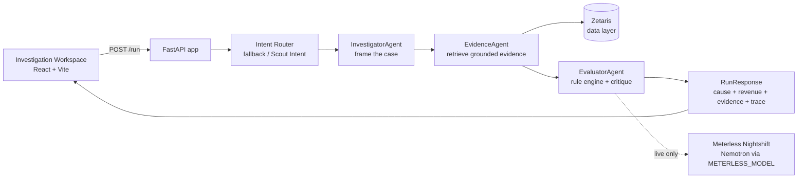
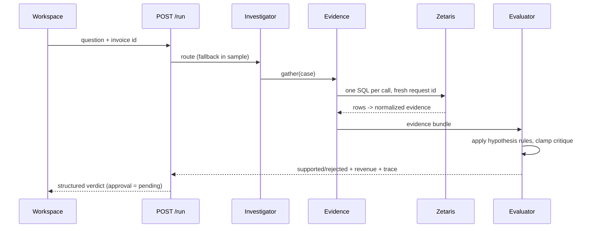

# Uhakika Labs — Institutional Contract Revenue Assurance

> **The agent that can explain *why* a supplier invoice is stuck — and prove it.**
> Open Agent Hackathon 2026 · Track 2 "The Agent That Can Explain Why".
>
> 

Uhakika investigates unpaid **public-sector / institutional supplier invoices** in
Tanzania, retrieves the underlying contract evidence, and returns a
**grounded, cite-able root cause** with the revenue at risk — not a guess, not a
chatbot summary, but a decision an accounts-payable officer and a supplier can
both audit.

---

## 1. The problem

Small and medium suppliers to Tanzanian public institutions routinely wait months
on invoices that are technically correct, because the real blocker is buried
across contracts, delivery logs, acceptance certificates, compliance/tax filings,
buyer correspondence, and payment-status systems. Nobody can quickly say *which*
stage is stuck, *why*, whose fault it is, and *what to do* — so revenue that is
already earned sits at risk.

Uhakika turns that hunt into a single, explainable question:

> *"Why hasn't our TZS 126,000,000 invoice been paid?"*

---

## 2. What it produces

Every run returns a structured, evidence-backed verdict:

| Field | Meaning |
|---|---|
| **Revenue at risk** | The uncollected amount (TZS), derived from the invoice minus paid. |
| **Supported cause** | One of five hypotheses, chosen by an evidence rule engine (highest priority wins). |
| **Blocker class** | Who can fix it — `supplier_controllable`, `execution_documentation`, or `external_payment`. |
| **Rejected causes** | The hypotheses ruled **out**, each with the evidence that rules it out. |
| **Evidence** | Cited evidence IDs + source summaries (contract clauses, delivery/acceptance records, compliance items, payment status, communications). |
| **Recommendation** | The concrete next step, gated behind an explicit **human approval** control. |
| **Trace** | An operational log of the agents' actions/decisions (never chain-of-thought, never secrets). |

The five hypotheses:

| ID | Hypothesis | Blocker class |
|----|------------|---------------|
| H1 | Delivery incomplete | `supplier_controllable` |
| H2 | Acceptance certificate missing | `execution_documentation` |
| H3 | Invoice submitted late | `supplier_controllable` |
| H4 | Required compliance / tax evidence missing | `execution_documentation` |
| H5 | External buyer / payment-stage blockage | `external_payment` |

Cause priority when several could apply: **H4 › H1 › H2 › H3 › H5** (a downstream
payment symptom never masks an upstream documentation blocker).

### The hero scenario

`INV-004` → **TZS 126,000,000** at risk → **H4 (compliance / tax evidence
missing)**. It is grounded by compliance item **CMP-005** (`required = true,
submitted = false`) read together with the contract's tax-documentation clause,
while H1/H2/H3 are each **rejected** by their own evidence. Corroborating
communication **MSG-037** supports the timeline but is never the sole basis.
Crucially, **removing CMP-005 downgrades H4 to "insufficient evidence"** — the
agent cannot assert the cause without the record that proves it.

---

## 3. How it works

Three cooperating agents plus a routing stage, behind one endpoint (`POST /run`):





### Honesty invariants (enforced by tests)

- **Conclusions are derived at runtime** — there is no stored "hero answer"; the
  evaluator reasons over the retrieved rows every time.
- **No evidence, no claim** — a hypothesis can only be *supported* if the specific
  grounding record exists; removing it downgrades the verdict (anti-fabrication).
- **Every business fact comes from Zetaris** — the evidence agent only queries
  through the Zetaris adapter (one statement per request, fresh request id).
- **Every product-AI claim comes through Nightshift** — the live model path is
  reached only via Meterless Nightshift; the deterministic router is honestly
  labelled `fallback` and is **never** mislabelled as Scout Intent.
- **Traces contain no chain-of-thought and no secrets** — operational
  actions/decisions only; secrets are masked and missing-config errors list
  variable **names** only.
- **A human approves** — recommendations are gated behind an explicit approval
  control; this V0 is **explain-only**, the autonomous ActionAgent is deferred.

---

## 4. Sponsor technology

| Sponsor | Role in Uhakika | Current state |
|---|---|---|
| **Zetaris** | The mandatory live data layer for all business evidence. | Sample adapter over synthetic CSV fixtures is fully wired; the live REST/Lightning-SQL adapter is a config-gated boundary, not yet run against a live instance. |
| **Meterless Nightshift** | The product AI runtime for every live model call. | Not yet wired — blocked on `METERLESS_RUNTIME_TOKEN`. |
| **Nemotron (via Nightshift)** | Powers the EvaluatorAgent's critique on the live path. | Not yet claimed; the model route comes from `METERLESS_MODEL` config only. |
| **Scout Intent** | Required live routing engine. | Live routing is `TBD`; the deterministic `fallback` router is used and honestly labelled until Scout Intent is verified. |

Sample mode runs end-to-end **without any credentials**, but it is explicitly
**not** sponsor proof. See [`SETUP.md`](SETUP.md) §7 for the full boundary
checklist and [`SUBMISSION.md`](SUBMISSION.md) for what is and is not claimed.

---

## 5. Quickstart (sample mode, ~2 minutes)

```bash
# backend
python -m venv .venv && .venv\Scripts\activate
pip install -r requirements.txt
set SAMPLE_MODE=true
.venv\Scripts\python.exe -m uvicorn agent.main:app --port 8000

# frontend (new terminal)
cd frontend && npm ci && npm run dev      # http://localhost:5173
```

Full setup, tests, clean-clone and Windows notes: **[`SETUP.md`](SETUP.md)**.

Try these three grounded inputs in the workspace:

| Input | Outcome |
|---|---|
| `INV-004` | H4 — compliance/tax evidence missing · TZS 126,000,000 · `execution_documentation` |
| `INV-005` | H1 — delivery incomplete · TZS 45,000,000 · `supplier_controllable` |
| `INV-006` | H5 — external payment-stage blockage · TZS 75,000,000 · `external_payment` |

Recorded sample inputs/outputs live in [`input_examples/`](input_examples) and
[`output_examples/`](output_examples); a sanitized operational trace is in
[`logs/sample_trace.jsonl`](logs/sample_trace.jsonl).

---

## 6. Project status

| Phase | Status |
|---|---|
| 1 Specification · 2 Foundation · 3 Zetaris data · 4 Agent thin slice · 5 Evaluator loop | ✅ complete & tagged |
| 7 Investigation Workspace (React) | ✅ complete & tagged |
| 8 Hardening & reproducibility (CI green on a clean clone) | ✅ complete & tagged |
| 9 Submission preparation | ✅ this document set |
| 6 Live Nightshift / Nemotron / Scout Intent | ⛔ **blocked** — needs `METERLESS_RUNTIME_TOKEN` (+ live `ZETARIS_*`) and validation of the live contracts. Not mocked, not claimed. |

68 backend tests green; frontend `tsc -b && vite build` green; GitHub Actions
runs both on every push with an empty environment.

---

## 7. Repository map

```
agent/            FastAPI app, config, domain models, three agents, adapters, logging
data/fixtures/    synthetic CSV evidence (hero + additional scenarios)
tests/            backend suite (pytest) — contracts, grounding, anti-fabrication, HTTP e2e
frontend/         React + TypeScript + Vite Investigation Workspace
input_examples/   output_examples/   logs/   reproducible sample artifacts (Phase 8)
docs:  PRD.md · ARCHITECTURE.md · DATA_CONTRACT.md · BUILD_PLAN.md · BUILD_LOG.md · SETUP.md · SUBMISSION.md
```

---

## 8. Disclosure — what was pre-existing, what was built, what ran it

- **Pre-existing before this build:** an early scaffold (`hello.py`,
  `smoke_test.py`) and a locally verified Zetaris instance. No application logic
  was reused from them.
- **Built during the build window:** the entire FastAPI backend, config/contract
  layer, three agents, the credential-free sample data adapter over synthetic
  fixtures, the React/Vite workspace, the test suite, CI, and all documentation.
- **Build tooling:** Qoder IDE with **Qwen 3.8 Flash** used for *authoring/build
  assistance only*. Qwen is **not** the product runtime and makes **no** claim to
  be Nemotron/Nightshift. No OpenRouter model was used.
- **No credentials or secrets are committed**; `.env` is never read by the
  application (it reads `os.environ` only). See [`AGENTS.md`](AGENTS.md).

---

*Uhakika Labs — "usihakikiwe, thibitisha" — don't just audit it, prove it.*
